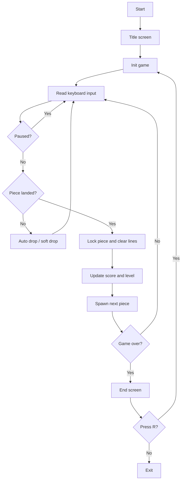

# Tetris (Command-Line Version)

[](https://gcc.gnu.org/)
[](https://www.microsoft.com/windows/)
[](https://en.cppreference.com/w/c/99)
[](LICENSE)

English | [简体中文](README.zh-CN.md)

## Overview

A Tetris game that runs in the Windows console. It is written in plain C, uses only the Windows console API, and keeps the entire game in a single source file.

The goal is to show that a playable Tetris does not need a graphics library: characters, colors and cursor positioning are enough. On top of the base rules the game has a 7-bag randomizer, a ghost piece, hold, wall kicks and a 500 ms lock delay. Drawing is incremental — only the cells that change are redrawn, and the board is repainted in full after a line clear.



### Features

- Seven tetrominoes with four rotations each; rotating against a wall shifts the piece inward
- 7-bag randomizer, so all seven pieces appear once per bag
- Ghost piece showing the landing position
- Hold slot (C), one swap per piece
- Lock delay of 500 ms after landing
- Scoring: 100 / 300 / 500 / 800 per line clear, multiplied by the level; soft drop 1 point per cell, hard drop 2
- One level per 10 cleared lines; each level shortens the drop interval by 15%, down to 50 ms
- High score saved to `tetris_highscore.txt` next to the executable

## Dependencies

- Windows 10 or 11
- GCC 15.2.0 (MinGW) or any C99-compatible compiler
- No third-party libraries; only the standard C headers and `windows.h`

The source file must stay UTF-8 encoded. The game switches the console code page on startup; without that the Chinese text and block characters come out garbled.

## Project Structure

```
Tetris-command_line_version/
├── 俄罗斯方块（命令行版）.cpp   # all game code
├── README.md                    # English documentation (main)
├── README.zh-CN.md              # Chinese documentation
├── LICENSE                      # MIT
└── .gitignore
```

## Usage

### Build

```bash
gcc "俄罗斯方块（命令行版）.cpp" -o "俄罗斯方块.exe"
```

### Run

```bash
./俄罗斯方块.exe
```

### Controls

| Key | Action |
| --------- | ---------------------- |
| ← → / A D | Move |
| ↑ / W | Rotate |
| ↓ / S | Soft drop |
| Space | Hard drop |
| C | Hold |
| P | Pause / resume |
| X | Quit |
| R | Restart after game over |

### Self test

```bash
./俄罗斯方块.exe --test
```

The test covers 7-bag distribution, boundary collision, line clearing and scoring, ghost position, wall kick and hold rules. Run it after changing the game logic.

## Contributing

Bug reports and pull requests are welcome. If a change touches the game rules, run `--test` before opening the PR. Keep the code in the single source file unless there is a clear reason to split it.

## Contact

**谙弆悕博士（Ailan Anjuxi）**

- Email: anjuxi.ME@outlook.com
- SIP: sip:anjuxi@sip.linphone.org
