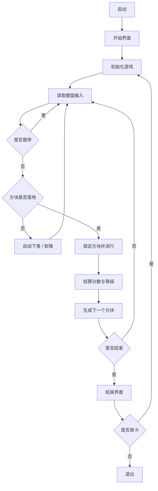

# 俄罗斯方块（命令行版）

[](https://gcc.gnu.org/)
[](https://www.microsoft.com/windows/)
[](https://en.cppreference.com/w/c/99)
[](LICENSE)

[English](README.md) | 简体中文

## 项目介绍

在 Windows 控制台里运行的俄罗斯方块。用纯 C 写成，只调 Windows 控制台 API，所有代码放在同一个源文件里。

做这个项目的想法很简单：不靠图形库，只用字符、颜色和光标定位，也能做出能玩的俄罗斯方块。在基础规则之外，加了 7-bag 随机、落点提示、暂存、墙踢和 500 毫秒锁定延迟。绘制采用增量更新，只重画变化的格子，消行时才整块刷新。



### 功能

- 七种方块，各四种朝向，贴墙旋转会自动往里让一格
- 7-bag 随机，一轮里七种方块各出现一次
- 灰色轮廓显示落点位置
- C 键暂存，每个方块只能换一次
- 落地后 500 毫秒锁定缓冲，还能再挪一下
- 消行得分 100 / 300 / 500 / 800，再乘当前等级；软降每格 1 分，硬降每格 2 分
- 每消 10 行升一级，每级下落间隔缩短 15%，最快 50 毫秒
- 最高分保存在程序目录的 `tetris_highscore.txt`

## 依赖说明

- Windows 10 / 11
- GCC 15.2.0（MinGW）或任意支持 C99 的编译器
- 没有第三方库，只用到标准 C 头文件和 `windows.h`

源文件需要保持 UTF-8 编码。程序启动时会把控制台切到 UTF-8，否则中文和方块字符会乱码。

## 项目结构

```
Tetris-command_line_version/
├── 俄罗斯方块（命令行版）.cpp   # 全部游戏代码
├── README.md                    # 英文文档（主文档）
├── README.zh-CN.md              # 中文文档
├── LICENSE                      # MIT
└── .gitignore
```

## 使用说明

### 编译

```bash
gcc "俄罗斯方块（命令行版）.cpp" -o "俄罗斯方块.exe"
```

### 运行

```bash
./俄罗斯方块.exe
```

### 按键

| 按键 | 作用 |
| --------- | -------------- |
| ← → / A D | 左右移动 |
| ↑ / W | 旋转 |
| ↓ / S | 软降 |
| 空格 | 硬降 |
| C | 暂存 |
| P | 暂停 / 继续 |
| X | 退出 |
| R | 结束后重新开始 |

### 自检

```bash
./俄罗斯方块.exe --test
```

自检覆盖 7-bag 分布、边界碰撞、消行计分、落点提示、墙踢和暂存规则，改完游戏逻辑先跑一遍。

## 贡献指南

发现问题可以提 issue，也欢迎直接发 pull request。改动涉及游戏规则时，提 PR 前先跑一次 `--test`。除非确有拆分必要，代码继续放在单个源文件里。

## 联系作者

**谙弆悕博士（Ailan Anjuxi）**

- 邮箱：anjuxi.ME@outlook.com
- SIP 电话：sip:anjuxi@sip.linphone.org
